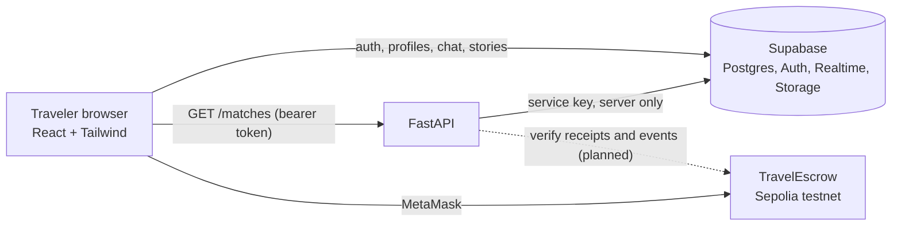

# VibeSync

**Find your people. Plan together. Book with trust.**

VibeTrip is a social travel platform that connects solo travelers heading to the same destination on overlapping dates, with compatible travel vibes. Travelers can find companions, send travel invitations, chat once they are connected, and  plan a trip together and secure a shared booking with a testnet blockchain escrow (in progress).

> **Hackathon prototype.** Built for a 24-hour hackathon. It uses fictional travelers, test funds and a testnet only. The smart contract is unaudited. Do not use real money.

---

## Contents

- [Features and status](#features-and-status)
- [How it works](#how-it-works)
- [Tech stack](#tech-stack)
- [Architecture](#architecture)
- [Project structure](#project-structure)
- [Getting started](#getting-started)
- [Environment variables](#environment-variables)
- [Matching algorithm](#matching-algorithm)
- [Escrow contract](#escrow-contract)
- [Security and privacy](#security-and-privacy)
- [Demo flow](#demo-flow)
- [Known limitations](#known-limitations)
- [Roadmap](#roadmap)

---

## Features and status

| Feature | What it does | Status |
|---|---|---|
| Authentication | Email and password sign up and login with Supabase Auth | Done |
| Onboarding | Four-step profile flow: about you, vibe, travel stories, next trip | Done |
| Traveler profiles | Public profile page with vibe, interests, stories and an edit form for the owner | Done |
| Smart matching | FastAPI endpoint ranks travelers by destination, overlapping dates and vibe, with "why you match" reasons | Done |
| Discover | Ranked match cards with score, reasons, verification badges and Show Interest | Done |
| Travel invitations | Send an invitation with a message, accept, decline or cancel, "It's a Vibe Match" celebration | Done, being tested |
| Connections and chat | Accepted connections page and realtime private chat between connected travelers | Done, being tested |
| Travel stories | Photo uploads (private bucket, up to 8) with title, place, date and public or private visibility | Done, being tested |
| Travel circles | Create, join and leave circles for a destination | Done, being tested |
| Trust and safety | Privacy tiers, honest verification flags, row-level security, report and block | Partly done |
| Escrow smart contract | Single-payer `TravelEscrow` contract with tests | Done locally, not deployed |
| Shared trip plan | Both travelers agree on destination, dates, accommodation, amount, payer and cancellation policy | Planned |
| Plan & Secure Trip | MetaMask deposit, server-side verification of the transaction, escrow status | Planned |
| Notifications | Bell with realtime updates | Planned |

> Update the status column as you finish and test each item.

---

## How it works

1. **Create a profile.** Choose your travel pace, budget style, social energy, interests and the kinds of places you love, then add your next trip.
2. **Discover travelers.** The matching API returns people going to the same destination with at least two overlapping days, ranked by how well your vibes fit.
3. **Show interest.** Send a short invitation. The database allows only one pending invitation per pair.
4. **Connect.** When the recipient accepts, a mutual connection is created and private chat unlocks.
5. **Plan together.** *(Planned)* Agree on the trip details in a shared plan.
6. **Secure the booking.** *(Planned)* The payer deposits test ETH into the escrow contract. The backend verifies the on-chain transaction before the payment counts.

---

## Tech stack

| Layer | Technology |
|---|---|
| Frontend | React, Vite, Tailwind CSS v4, React Router, `@supabase/supabase-js`, `ethers` |
| Backend | Python, FastAPI, Uvicorn, `supabase-py`, `python-dotenv` |
| Database and auth | Supabase: PostgreSQL, Auth, Realtime, Storage, Row Level Security |
| Matching | Weighted scoring in plain Python, no ML library |
| Blockchain | Solidity 0.8.24, Hardhat 2, Sepolia testnet, MetaMask |

---

## Architecture



- The frontend talks to Supabase directly for auth, profiles, trips, invitations, chat and stories. Row Level Security decides what each user can read and write.
- FastAPI handles matching today. Server-side verification of blockchain transactions and the simulated provider-status issuer are planned.
- The blockchain handles money movement and policy events only. No personal data goes on-chain.

---

## Project structure

```
vibetrip/
  backend/
    main.py                  FastAPI app: GET /matches/{user_id}
    matching.py              Scoring functions
    vibe_codes.py            Option codes (mirror of the frontend)
    test_matching.py         Test with fake travelers
    create_test_users.py     Creates confirmed test users without sending email
    requirements.txt
  contracts/
    contracts/TravelEscrow.sol
    test/TravelEscrow.test.js
    scripts/deploy.js
    hardhat.config.js
  frontend/
    src/
      lib/                   supabase.js, vibeOptions.js
      context/               AuthContext.jsx
      components/            TravelStories.jsx, InviteModal.jsx
      pages/                 Landing, Login, Onboarding, Discover, Profile,
                             Invitations, Connections, Chat, Circles
  supabase/                  SQL files, run in numeric order (see below)
```

---

## Getting started

### Prerequisites

- Node.js 18 or newer
- Python 3.10 or newer
- A free [Supabase](https://supabase.com) project
- [MetaMask](https://metamask.io) (only for the escrow part)
- Git

### 1. Clone and install

```bash
git clone https://github.com/<your-username>/vibetrip.git
cd vibetrip
```

### 2. Set up Supabase

1. Create a project, then copy the **Project URL**, the **publishable (anon) key** and the **secret (service-role) key** from the project's API settings. The URL must end at `.supabase.co`.
2. Open **SQL Editor** and run the files in `supabase/` **in numeric order**. Each one depends on the earlier ones:

| File | Creates |
|---|---|
| `01_schema.sql` | `profiles`, `trips` and their policies |
| `02_flags.sql` | Verification and admin flags, with a trigger that stops users editing them |
| `03_circles.sql` | Connections, circles, members, messages |
| `04_bookings.sql` | Bookings and booking events |
| `05_safety.sql` | Reports and blocks |
| `06_stories.sql` | Travel stories, a private storage bucket and storage policies |
| `07_invitations.sql` | Invitations, mutual connections, notifications, direct messages and the functions that change invitation state |

3. In **Authentication → Sign In / Providers → Email**, make sure the Email provider is enabled.

### 3. Run the backend

```powershell
cd backend
python -m venv venv
venv\Scripts\Activate.ps1          # macOS/Linux: source venv/bin/activate
pip install -r requirements.txt
```

Create `backend/.env` (see [Environment variables](#environment-variables)), then start the server:

```powershell
uvicorn main:app --reload
```

The API runs at `http://127.0.0.1:8000`, and interactive docs are at `/docs`.

Optional: run the matching test.

```powershell
python test_matching.py
```

### 4. Run the frontend

```powershell
cd frontend
npm install
```

Create `frontend/.env`, then:

```powershell
npm run dev
```

Open the address Vite prints (normally `http://localhost:5173`). Restart the dev server after changing `.env`.

### 5. Create test accounts (no emails)

Supabase's default email sender is limited to a few emails per hour, so sign-ups made through the form can fail with `email rate limit exceeded`. Create confirmed test users directly instead:

```powershell
cd backend
python create_test_users.py
```

Then use **Log in**, not **Create account**. The script prints the test password. Use these accounts for local testing only.

To test two travelers at once, log in as one in a normal window and the other in an incognito window.

### 6. Smart contract (optional, local)

```powershell
cd contracts
npm install
npx hardhat test                                   # 8 tests should pass
npx hardhat node                                   # terminal 1: local chain
npx hardhat run scripts/deploy.js --network localhost   # terminal 2
```

Deployment writes `deployments/localhost.json` (address) and `deployments/TravelEscrow.abi.json` (interface). To deploy to Sepolia, fill in `contracts/.env` (see below) and run the deploy script with `--network sepolia`.

---

## Environment variables

Copy the examples and fill in your values. **Never commit a real `.env` file.**

| File | Variable | Purpose |
|---|---|---|
| `frontend/.env` | `VITE_SUPABASE_URL` | Supabase project URL, ending at `.supabase.co` |
| | `VITE_SUPABASE_ANON_KEY` | Publishable (anon) key. Safe for the browser |
| | `VITE_API_URL` | FastAPI address, for example `http://127.0.0.1:8000` |
| `backend/.env` | `SUPABASE_URL` | Same project URL |
| | `SUPABASE_SERVICE_KEY` | **Secret** service-role key. Backend only |
| `contracts/.env` | `SEPOLIA_RPC_URL` | Sepolia RPC endpoint (Alchemy or Infura) |
| | `DEPLOYER_PRIVATE_KEY` | Private key of a throwaway test wallet |
| | `ISSUER_ADDRESS` | Address of a second throwaway wallet that acts as the demo status issuer |

---

## Matching algorithm

Matching is a function of two travelers: it returns either "excluded" or a score from 0 to 100.

**Gate (otherwise excluded)**
- Same destination, ignoring case and spaces
- Trip dates overlap by at least 2 days
- Neither traveler has blocked the other, and neither profile is hidden

**Score**

| Component | Weight | How it is compared |
|---|---|---|
| Budget style | 25 | Closeness on a four-step scale. "Depends" counts as neutral |
| Travel pace | 25 | Closeness on a three-step scale. "Go with the flow" counts as neutral |
| Landscape | 10 | Same, or compatible when one loves both |
| Social energy | 10 | Closeness. "Let's see" counts as neutral |
| Interests | 10 | Shared interests divided by the smaller list |
| Optional preferences | 10 | Share of comparable answers that match |
| Group size | 10 | Difference between preferred group sizes |

Each match includes a "why you match" list. Option values are stored as stable codes (for example `slow`, `comfort_budget`), so labels can be reworded without breaking old data.

The endpoint is `GET /matches/{user_id}` and needs a Supabase access token (`Authorization: Bearer <token>`). It verifies that the token belongs to the requested user and returns only public profile fields.

---

## Escrow contract

`TravelEscrow` holds the funds for **one booking and one payer**, in the chain's native test coin.

| Function | Who can call it | Effect |
|---|---|---|
| `fundBooking` | The payer | Locks the amount and records the recipient, cancellation deadline, release time and refund policy. Emits `BookingFunded` |
| `cancelByPayer` | The payer, before the release time | Refunds the agreed percentage. The remainder goes to the recipient |
| `confirmProviderCancellation` | The issuer only | Full refund to the payer |
| `release` | The payer any time. The recipient or issuer after the release time | Pays the recipient |

Each booking can be settled only once.

**Important limitation:** there is no real hotel or provider integration. The issuer is a single trusted address, run by the backend, that stands in for a provider's cancellation confirmation. The blockchain proves what was paid and refunded. It cannot prove that a provider actually cancelled.

Transactions cost gas, and a confirmed transaction cannot be reversed.

---

## Security and privacy

- **Row Level Security** is enabled on every table. Users manage their own rows, and other travelers can read only what is marked public.
- **Protected fields.** A database trigger stops signed-in users from changing their own verification flags or admin flag.
- **Invitations are changed only by database functions.** Browsers cannot insert, update or delete invitation or connection rows. The functions check who is calling, block checks, date overlap and duplicates.
- **Private messages** are readable only by the two people involved and can be sent only between connected travelers who have not blocked each other.
- **Private photo storage.** Story photos are in a private bucket and are shown through short-lived signed links. Another traveler can read a photo only while its story is public.
- **Secrets stay on the server.** The service-role key and private keys never appear in frontend code.
- **Profile privacy.** Email, phone, ID documents and precise location are never shown. Home location is city level only.
- **Verification badges** reflect checks that were actually performed. "Not verified" is shown neutrally and is not a safety judgment.

---

## Demo flow

1. Sign up and set your vibe (or log in with a prepared test account).
2. Open Discover and see matches ranked with reasons.
3. Show interest in a traveler. In a second window, accept the invitation and see "It's a Vibe Match".
4. Chat in real time.
5. *(Planned)* Agree on a shared trip plan, deposit into escrow with MetaMask, and follow the booking status.
6. Show a public profile with travel stories, and the privacy controls.

---

## Known limitations

- Supabase's default email sender is rate limited. Use `create_test_users.py` for test accounts, or configure your own SMTP provider.
- Matching uses each traveler's latest trip.
- Provider cancellations are simulated by the issuer address.
- The escrow contract supports one payer only and is not audited.
- Some photos on the landing and onboarding pages load from Unsplash. If one is missing, the page falls back to a gradient.

---

## Roadmap

- [ ] Shared trip plan with agreement by both travelers
- [ ] Backend verification of transaction receipts and contract events
- [ ] Plan & Secure Trip screen with MetaMask
- [ ] Deploy the contract to Sepolia
- [ ] Notification bell with realtime updates
- [ ] Report and block screens, and an admin page
- [ ] Seed data and demo polish

---

